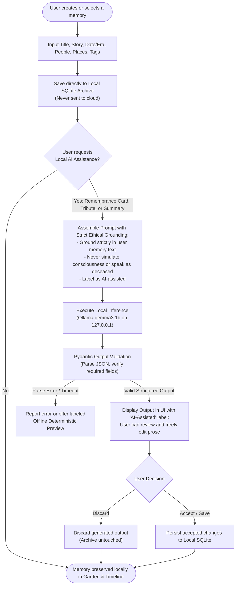

# Echoes — A Private, Local-First Memory Garden

> **"Some stories deserve to stay with us."**

[](LICENSE)
[](https://dev.to/challenges/hacktoberfest-week4-2026-10-26)
[-blue.svg)](#local-ai-setup-ollama)
[](docs/PRIVACY.md)

**Echoes** is a privacy-first, local-first digital sanctuary designed to preserve meaningful stories, family memories, oral histories, important milestones, and the quiet details that might otherwise be forgotten over time.

Built for the **Hacktoberfest 2026 Open-Source AI Challenge (Week 4: Ghost in the Machine)**, Echoes pairs local SQLite storage with an on-device open-weight model (**Google's `gemma3:1b`** running locally via Ollama) to organize, summarize, and reflect upon your memories without ever sending your words to a cloud service.

- **GitHub Repository**: [https://github.com/Tanmay-Dalvi/echoes](https://github.com/Tanmay-Dalvi/echoes)
- **Challenge Entry**: [Hacktoberfest Week 4: Ghost in the Machine](https://dev.to/challenges/hacktoberfest-week4-2026-10-26)

---

## The Problem Echoes Solves

Most digital archives and modern AI tools present families with an unacceptable dilemma:
1. **Cloud AI Exploitation**: Uploading intimate family memories to commercial cloud LLMs exposes private lives to centralized data mining, telemetry, and potential model training.
2. **Ephemeral Cloud Lock-In**: Hosted services sunset products, change APIs, or mandate subscriptions, putting family heritage at risk of being lost.
3. **Disrespectful "Resurrection" AI**: Gimmicky chatbots claiming to "recreate" deceased individuals often hallucinate facts and fabricate false memories.

**Echoes takes a different path:**
- **Zero Cloud Leakage**: Runs 100% on your machine over local loopback (`127.0.0.1`).
- **Grounded AI Assistance**: On-device `gemma3:1b` assists as an archivist (extracting people, places, dates, and drafting commemorative tributes) strictly grounded in what you provide, with mandatory human-in-the-loop review.
- **Permanent Sovereignty**: Complete SQLite storage and Schema Version 1 JSON backup/restore ensures your archive belongs to you forever.

---

## Screenshots & Visual Tour

> [!NOTE]
> The screenshots below illustrate the key screens of Echoes. These paths serve as placeholders until you capture and place your preferred screenshots into `docs/screenshots/`.

| Screen | Description |
| :--- | :--- |
|  | **Memory Garden Dashboard**<br>Warm parchment aesthetic, instant SQLite FTS5 search, overview metrics, and category filtering. |
|  | **The Stream of Time (Timeline)**<br>Chronological generational stream with respectful handling of approximate eras and undated memories. |
|  | **AI Remembrance Card Studio**<br>On-device open-weight inference with `gemma3:1b` crafting poignant keepsake cards in ~2 seconds. |
|  | **Preserve Memory with AI Entity Extraction**<br>Auto-extracts candidate people, places, and tags from stories with user review before saving. |
|  | **Backup, Export & Privacy Notice**<br>Full JSON archive export, atomic import with conflict resolution, and demo data isolation. |

---

## Features

- 🌿 **Warm Parchment Interface**: Quiet, atmospheric aesthetic inspired by memory gardens, candlelight gold accents, and legible serif typography.
- ⚡ **Sub-Millisecond Full-Text Search**: Powered by SQLite's native **FTS5** virtual table with Porter stemming and automated trigger synchronization.
- 🕰️ **Chronological Stream & Timeless Eras**: Orders memories chronologically while placing approximate eras (*"Summer 1975"*, *"Childhood"*) and undated stories in dedicated, unforced spaces.
- 🪶 **On-Device Open-Weight AI (`gemma3:1b`)**:
  - **Remembrance Card Studio**: Crafts evocative keepsake cards with essence, key elements, and quoted moments.
  - **Reflective Tribute Writer**: Composes grounded commemorative essays with live text review before saving.
  - **Entity Extraction**: Auto-suggests people, locations, eras, and themes during story authoring.
  - **Oral History Synthesis**: Weaves multi-generational stories into a unified family narrative.
- 🎭 **Isolated Fictional Demo Archive**: Includes 6 pre-seeded fictional stories spanning 1944 to 2005 for immediate reviewer exploration. Demo memories are visibly badged and can be cleared with one click without touching real personal memories.
- 📦 **Data Sovereignty & Portability**: Export your archive to clean JSON files and restore with atomic transaction protection and configurable conflict strategies (*Skip Duplicates*, *Overwrite*, or *Keep Both*).

---

## Architecture & Data Flows

Echoes strictly enforces a local loopback security boundary. No outbound network requests are made during memory operations or inference.

```mermaid
flowchart TD
    subgraph Client["Frontend Client (Browser - Port 5173)"]
        UI["Echoes Web UI\n(React 19 + TypeScript + Tailwind v4)"]
        Garden["Memory Garden Dashboard"]
        Timeline["Timeline View"]
        Studio["AI Studio"]
        Backup["Backup & Portability"]
        UI --> Garden
        UI --> Timeline
        UI --> Studio
        UI --> Backup
    end

    subgraph PrivacyBoundary["Strict Privacy Boundary (127.0.0.1 Loopback Only)"]
        API["FastAPI Backend Service\n(Port 8000 / Uvicorn)"]
        Router["API Routers\n(/memories, /ai, /backup, /demo)"]
        PydanticVal["Structured Output Validation\n(Pydantic V2 Schemas)"]
        DBEngine["Storage Engine\n(SQLite3 + FTS5 Full-Text Search)"]
        OllamaBridge["Ollama Client Adapter\n(Strict Grounding & Ethics Prompts)"]
        API --> Router
        Router --> DBEngine
        Router --> OllamaBridge
        OllamaBridge --> PydanticVal
    end

    subgraph LocalStorage["Local Disk Storage"]
        DBFile[("./data/echoes.db\nSQLite File")]
        ExportFile[("User JSON Backups\nechoes-archive-*.json")]
        DBEngine --> DBFile
        Backup -.-> ExportFile
    end

    subgraph LocalInference["Local Open-Weight Inference (Port 11434)"]
        OllamaSvc["Ollama Daemon\n(http://127.0.0.1:11434)"]
        GemmaModel["gemma3:1b Model Weights\n(806 MB Q4 Quantized)"]
        OllamaSvc --> GemmaModel
    end

    UI <== "HTTP / JSON Proxy" ==> API
    OllamaBridge <== "Local Loopback POST" ==> OllamaSvc
    PydanticVal ==> "Validated Structured Result" ==> Studio
    Studio ==> "User Review & Explicit Approval" ==> Router
```

### Memory Lifecycle & AI Reflection Data Flow



---

## Technology Stack

| Layer | Technology | Purpose | Reference |
| :--- | :--- | :--- | :--- |
| **Frontend Framework** | React 19 + TypeScript | UI component hierarchy and type safety | [react.dev](https://react.dev) |
| **Styling & Icons** | Tailwind CSS v4 + Lucide React | High-contrast accessible parchment theme | [tailwindcss.com](https://tailwindcss.com) |
| **Frontend Tooling** | Vite 8 | Ultra-fast development and optimized production bundling | [vite.dev](https://vite.dev) |
| **Backend API** | FastAPI + Python 3.14 | High-performance asynchronous REST endpoints on loopback | [fastapi.tiangolo.com](https://fastapi.tiangolo.com) |
| **Database** | SQLite 3 with FTS5 | Zero-config, single-file storage with native full-text search | [sqlite.org](https://sqlite.org) |
| **AI Inference** | Ollama | Local runtime managing open-weight models | [ollama.com](https://ollama.com) |
| **Open-Weight Model** | Gemma 3 1B (`gemma3:1b`) | 806 MB lightweight model with rapid inference on CPU/iGPU | [ai.google.dev/gemma](https://ai.google.dev/gemma) |
| **Data Validation** | Pydantic V2 | Strict schema validation for inputs and AI outputs | [docs.pydantic.dev](https://docs.pydantic.dev) |
| **Testing** | Pytest + Vitest | Comprehensive backend and frontend automated testing | [pytest.org](https://pytest.org) / [vitest.dev](https://vitest.dev) |

---

## Quick Start (Local Installation)

### Prerequisites
- Linux or macOS (Ubuntu/Debian tested)
- Python 3.10+
- Node.js 18+ (Node v24 tested)
- Git
- [Ollama](https://ollama.com/) (optional, for live AI assistance)

### 1. Clone Repository
```bash
git clone https://github.com/Tanmay-Dalvi/echoes.git
cd echoes
```

### 2. Set Up and Start Backend
```bash
# Create virtual environment and install dependencies
python3 -m venv backend/venv
source backend/venv/bin/activate
pip install -r backend/requirements.txt

# Start backend server on loopback 127.0.0.1:8000
uvicorn backend.app.main:app --host 127.0.0.1 --port 8000
```

### 3. Set Up and Start Frontend
In a second terminal:
```bash
cd echoes/frontend
npm install

# Start Vite server on loopback 127.0.0.1:5173
npm run dev -- --host 127.0.0.1 --port 5173
```

Open your browser to: **`http://127.0.0.1:5173`**

---

## Deploying to Render (Cloud Preview Demo)

Echoes is engineered primarily as a local-first application to guarantee memory sovereignty. For reviewers, hackathon judges, or public demonstrations, Echoes can also be deployed to [Render](https://render.com) using its root [`render.yaml`](render.yaml) Blueprint.

### Cloud Architecture & Privacy Integrity

| Aspect | Local Self-Hosted Mode | Render Cloud Preview |
| :--- | :--- | :--- |
| **Binding** | Strict loopback `127.0.0.1:8000` | Public Web Service (`0.0.0.0:$PORT`) |
| **CORS** | `http://127.0.0.1:5173` | Restricted to `*.onrender.com` & configured origins |
| **Ollama AI** | On-device `gemma3:1b` (live inference) | Truthful **`AI Offline (Archive Active)`** status + labeled deterministic demo mode |
| **Storage** | Persistent local `./data/echoes.db` | Ephemeral container (Free tier) or Persistent Disk (`/var/data`) |
| **Cloud Telemetry** | **Zero** | **Zero** (no external tracking or silent LLM leakages) |

> [!IMPORTANT]
> **No Silent Cloud Leakage**: Cloud services on Render cannot reach an Ollama daemon running on a reviewer's personal laptop (`127.0.0.1:11434`). When deployed remotely, Echoes honestly reports the AI service as offline and activates the labeled deterministic fallback demo mode. It **never** silently ships memory text to proprietary cloud LLMs.

### 1-Click Blueprint Deployment via Render

1. Fork or push this repository to GitHub.
2. In the [Render Dashboard](https://dashboard.render.com), click **New +** > **Blueprint**.
3. Connect your repository. Render reads `render.yaml` to deploy:
   - **`echoes-backend`**: FastAPI Python Web Service (runs Uvicorn on `0.0.0.0:$PORT` with health check at `/api/health`).
   - **`echoes-frontend`**: Vite React Static Site (builds with `VITE_API_BASE_URL` dynamically injected).
4. For complete manual deployment steps, persistent disk configuration, and troubleshooting, consult the [Render Deployment Guide](docs/DEPLOYMENT_RENDER.md).

---

## Local AI Setup (Ollama)

1. **Install Ollama**: Follow instructions at [ollama.com](https://ollama.com/download).
2. **Pull the Open-Weight Model**:
   ```bash
   ollama pull gemma3:1b
   ```
   *Size: 806 MB (Q4_K_M quantized). Runs comfortably on 16 GB RAM with integrated graphics.*
3. **Verify Ollama is Running**:
   ```bash
   curl -s http://127.0.0.1:11434/api/tags
   ```
4. **Offline / Missing-Model Behavior**:
   If Ollama is stopped or the model is not installed, the top navigation banner truthfully indicates **"AI Offline (Archive Active)"**. All core functions (creating, editing, searching, timeline navigation, exporting, and importing) remain 100% operational. An explicit **Deterministic Demo Fallback** toggle is provided in the AI studio for offline testing.

---

## Privacy & Security Summary

| Principle | Echoes Implementation |
| :--- | :--- |
| **Data Residency** | All memories reside in `./data/echoes.db` on your local filesystem. |
| **Network Boundary** | Backend binds strictly to `127.0.0.1:8000`. No remote network discovery. |
| **Telemetry & Trackers** | **Zero.** No Google Analytics, Sentry, Mixpanel, or third-party pixels. |
| **External Fonts / CDNs** | **None.** Uses local system serif/sans-serif fonts and inline SVGs. |
| **Cloud Fallback** | **Forbidden.** Echoes never silently forwards memories to cloud LLMs. |
| **Data at Rest** | Local SQLite storage is unencrypted by default. Users archiving sensitive histories should enable host full-disk encryption (LUKS / FileVault / BitLocker). |

For complete security details, see [docs/SECURITY.md](docs/SECURITY.md) and [docs/PRIVACY.md](docs/PRIVACY.md).

---

## Repository Map

```text
echoes/
├── backend/
│   ├── app/
│   │   ├── database.py       # SQLite + FTS5 engine & atomic transactions
│   │   ├── demo_data.py      # Fictional demo memories (explicitly badged)
│   │   ├── main.py           # FastAPI initialization & loopback CORS
│   │   ├── models.py         # Pydantic V2 schemas for memories & AI outputs
│   │   ├── ollama_client.py  # Local Ollama client with strict negative grounding
│   │   └── routes/           # REST endpoints (/memories, /ai, /backup)
│   ├── requirements.txt
│   └── tests/                # 17 automated pytest unit and integration tests
├── frontend/
│   ├── src/
│   │   ├── App.tsx           # Global state, tabs, notification & modal orchestration
│   │   ├── api.ts            # Typed REST client with Vite proxy integration
│   │   ├── components/       # MemoryGardenView, TimelineView, AIAssistantView, BackupView, Modals
│   │   ├── types.ts          # TypeScript interfaces
│   │   └── __tests__/        # 4 Vitest test suites (6 passing tests)
│   ├── package.json
│   └── vite.config.ts
├── data/                     # Local SQLite database (./data/echoes.db - gitignored)
├── docs/
│   ├── ARCHITECTURE.md       # Technical architecture & schema specifications
│   ├── DEMO.md               # 3-minute guided reviewer script
│   ├── DEPLOYMENT_RENDER.md  # Render cloud preview deployment & environment guide
│   ├── DEV_SUBMISSION.md     # Official DEV Community submission draft
│   ├── IMPLEMENTATION_NOTES.md # Hardware benchmarks & design decisions
│   ├── PRIVACY.md            # Privacy boundary & data at rest analysis
│   ├── SECURITY.md           # Security policy & threat model
│   ├── diagrams/             # Mermaid diagram source files
│   └── screenshots/          # Repository screenshot placeholder directory
├── .env.example
├── .gitignore
├── CONTRIBUTING.md
├── LICENSE                   # MIT License
├── pytest.ini
└── render.yaml               # Render Blueprint (FastAPI Web Service + Vite Static Site)
```

---

## Automated Testing & Build Results

### Backend Tests (Pytest)
```bash
source backend/venv/bin/activate
PYTHONPATH=. pytest backend/tests -v
```
**Result**: `17 passed in 0.49s` (CRUD, FTS5 search, timeline sorting, demo isolation, backup conflict resolution, atomic import rollback, loopback privacy).

### Frontend Tests (Vitest)
```bash
cd frontend
npm test
```
**Result**: `4 test suites, 6 passed in 1.41s` (Navbar routing, MemoryCard metadata & demo badges, Timeline rendering, BackupView controls).

### Production Build
```bash
cd frontend
npm run build
```
**Result**: Clean compilation with `dist/` bundle generated in ~250ms.

---

## Known Limitations & Roadmap

- **Unencrypted SQLite on Disk**: The database file `./data/echoes.db` is unencrypted at rest. For sensitive personal oral histories, full-disk encryption (LUKS / FileVault / BitLocker) is strongly recommended.
- **Local Audio Recording**: Future releases will support direct audio oral history recording with on-device transcription via Whisper.cpp.
- **Hardware Variations**: Systems without AVX2 instruction sets may experience slower inference times (>10s) with `gemma3:1b`.

---

## Hacktoberfest 2026 Submission

- **Challenge**: Hacktoberfest Open-Source AI Challenge (Week 4: Ghost in the Machine)
- **Theme Connection**: In ancestral traditions like Día de los Muertos, a person truly dies only when they are forgotten by the living. Echoes honors this tradition not by fabricating simulated digital specters or fake consciousness, but by providing a tranquil sanctuary where real human memories can be lovingly preserved, organized, and passed down across generations using open-weight AI that stays in the user's hands.
- **Submission Article Draft**: See [`docs/DEV_SUBMISSION.md`](docs/DEV_SUBMISSION.md).

---

## Contributing

Contributions are warmly welcomed! Please read [CONTRIBUTING.md](CONTRIBUTING.md) for architectural guidelines, code standards, and our ethical commitments.

---

## License

Echoes is licensed under the **MIT License**. See [LICENSE](LICENSE) for details.
