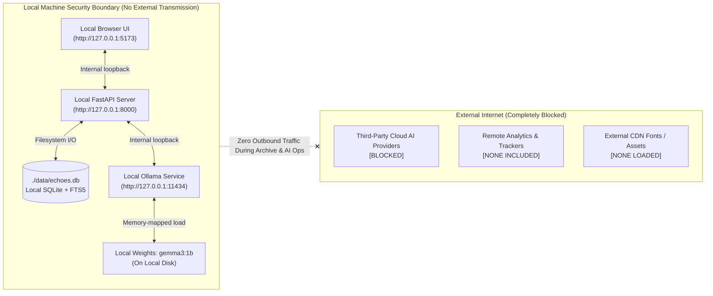

# Privacy & Data Sovereignty — Echoes

**Echoes: A Private Memory Garden** treats personal stories, family recollections, and oral histories with the solemnity they deserve.

---

## 1. Zero Cloud Transmission

- **No Remote Telemetry**: Echoes contains zero analytics libraries, crash reporters, user tracking pixels, or third-party monitoring scripts.
- **No Cloud AI APIs**: Echoes communicates exclusively with an open-weight model (`gemma3:1b`) loaded onto your local CPU/GPU through Ollama. Your memories are never sent to OpenAI, Google Cloud, Anthropic, or any hosted API.
- **No Remote Fonts or CDNs**: All styling, fonts, and icons are rendered from system fonts and embedded SVGs. No requests are made to Google Fonts, CDNjs, or Unpkg.

## 2. Network Deployment Boundary

- The backend service binds strictly to loopback (`127.0.0.1:8000`).
- The frontend server binds strictly to loopback (`127.0.0.1:5173`).
- Echoes does not listen on `0.0.0.0`. It cannot be discovered or accessed by other devices on your local Wi-Fi or LAN.

## 3. Data Storage & Encryption Advisory

- **Database Location**: Memories are stored in a standard SQLite file at `./data/echoes.db`.
- **Data at Rest**: Standard SQLite files are stored unencrypted on your filesystem.
  > [!IMPORTANT]
  > Because local storage is unencrypted by default, users archiving sensitive family or historical documents should ensure their host device has full-disk encryption enabled (LUKS on Linux, FileVault on macOS, or BitLocker on Windows).

## 4. Ethical AI Boundaries

- **Grounded in Preserved Facts**: The AI assistant only organizes, summarizes, and reflects on words you enter. It is prohibited from fabricating dates, relatives, or life events.
- **No Consciousness Emulation**: Echoes never claims to commune with spirits or recreate the consciousness of departed loved ones. All AI outputs are labeled as "AI-Assisted".
- **User Veto & Editing**: Generated summaries, remembrance cards, and tributes are presented for user review before anything is saved to the database.

## 5. Fictional Demo Data

Echoes never includes personal memories or private conversations in test fixtures or seed data. All sample stories provided in the repository and demo seed feature are explicitly fictional, respectful creative compositions.

